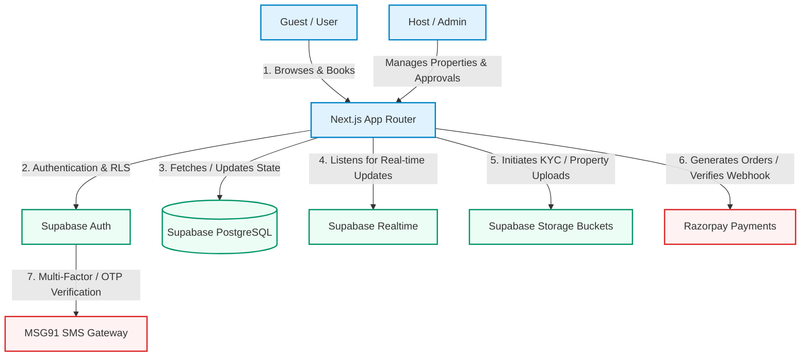

# 🏔️ StayCool Booking - Complete Developer Setup & Architecture Guide

Welcome to the **StayCool Booking Developer Setup Guide**. This guide provides an end-to-end walkthrough for installing, configuring, running, and testing the StayCool Booking SaaS application locally.

---

## 🏗️ System Architecture Flow

The following diagram illustrates how the Next.js App Router, Supabase (Database, Auth, Storage, and Realtime), Razorpay Payment Gateway, and MSG91 OTP service interact:



---

## 🛠️ Prerequisites

Ensure you have the following system software installed before proceeding:

| Software | Minimum Version | Verification Command |
| :--- | :--- | :--- |
| **Node.js** | `v18.x` or higher | `node -v` |
| **npm** | `v9.x` or higher | `npm -v` |
| **Git** | `v2.x` or higher | `git --version` |
| **Supabase CLI** (Optional) | `v1.x` | `supabase -v` |

---

## 🚀 Step-by-Step Installation

### Step 1: Clone the Repository & Install Dependencies
First, navigate to your workspace and install all npm packages:

```bash
# Verify you are using the node version in .nvmrc
nvm use

# Install package dependencies
npm install
```

> [!NOTE]
> All dependencies are pinned in [package.json](file:///e:/staycoolbooking1/package.json) to guarantee Next.js 15 App Router compatibility.

---

### Step 2: Configure Environment Variables
Copy the environmental variables template file:

```bash
cp .env.example .env
```

Open [.env](file:///e:/staycoolbooking1/.env) and populate the values:

```env
# ------------------------------------------------------------------------------
# Supabase Configuration
# ------------------------------------------------------------------------------
NEXT_PUBLIC_SUPABASE_URL=your_supabase_project_url
NEXT_PUBLIC_SUPABASE_ANON_KEY=your_supabase_anon_key
SUPABASE_SERVICE_ROLE_KEY=your_supabase_service_role_key

# ------------------------------------------------------------------------------
# Default Admin Credentials (For Seeding & Login)
# ------------------------------------------------------------------------------
ADMIN_EMAIL=admin@staycool.com
ADMIN_PASSWORD=DefaultPassword123!

# ------------------------------------------------------------------------------
# Razorpay Configuration (Payments)
# ------------------------------------------------------------------------------
NEXT_PUBLIC_RAZORPAY_KEY_ID=your_razorpay_key_id
RAZORPAY_KEY_SECRET=your_razorpay_key_secret

# ------------------------------------------------------------------------------
# MSG91 Configuration (SMS & OTP Verification - Optional fallback)
# ------------------------------------------------------------------------------
MSG91_AUTH_KEY=your_msg91_auth_key
MSG91_TEMPLATE_ID=your_msg91_template_id
```

> [!WARNING]
> The `SUPABASE_SERVICE_ROLE_KEY` bypasses all Row-Level Security (RLS) policies. **Never** expose this key on the client side or push it to version control.

---

### Step 3: Database & Schema Setup

To set up the complete PostgreSQL database structure including all tables, functions, triggers, and dummy data, you need to import the backup SQL dump:

1. **Get the Backup File**: The primary schema restore file is [backup.sql](file:///e:/staycoolbooking1/backup.sql) located at the root of the project.
2. **Apply the Backup**:
   - Go to your **Supabase Project Dashboard**.
   - Navigate to the **SQL Editor** tab on the left sidebar.
   - Click **New Query**.
   - Copy the entire content of [backup.sql](file:///e:/staycoolbooking1/backup.sql) and paste it into the editor.
   - Click **Run** to execute the setup script.

> [!TIP]
> Ensure you apply any incremental migrations located under `database/migrations/` sequentially to keep the schema aligned with recent feature updates.

---

### Step 4: Storage Buckets Configuration

StayCool Booking requires two primary storage buckets. Create them via your **Supabase Dashboard** -> **Storage**:

1. **`property-images`**
   - **Access**: `Public`
   - **Purpose**: For property gallery uploads, banner pictures, and host listing attachments.
2. **`kyc-documents`**
   - **Access**: `Private` (Restricted)
   - **Purpose**: For secure guest and host identification uploads (Aadhaar, Passport, etc.).
   - **Security**: Controlled by custom RLS policies, allowing reading only by users with the `admin` role.

---

### Step 5: Start the Development Server

Start the local server in development mode:

```bash
npm run dev
```

The application will launch on [http://localhost:3000](http://localhost:3000).

---

## 💳 Payment Gateway Setup (Razorpay)

To configure Razorpay for capturing booking payments:

1. Log in to the [Razorpay Dashboard](https://dashboard.razorpay.com/).
2. Navigate to **Account & Settings** -> **API Keys** and generate a new key pair in **Test Mode**.
3. Save the `Key ID` and `Key Secret` inside your `.env` file.
4. Set up a Webhook in Razorpay settings:
   - **Webhook URL**: `https://your-domain.com/api/payments/razorpay/webhook` (Use `ngrok` or similar tunnel for testing locally: e.g., `https://xxxx.ngrok-free.app/api/payments/razorpay/webhook`).
   - **Secret**: Set a random secret and store it in your backend configuration.
   - **Active Events**:
     - `payment.captured`
     - `payment.failed`
     - `refund.processed`

---

## 💬 OTP Verification Setup (MSG91)

The platform supports OTP authentication via **MSG91** with automatic fallback to standard Supabase built-in OTP services if not configured.

To set up MSG91:
1. Register on the [MSG91 Portal](https://msg91.com/).
2. Under the SMS panel, create a new **OTP Template**.
3. Retrieve your **Auth Key** and **Template ID** and configure them in `.env`.
4. The backend service in the codebase will route messages through this service automatically.

---

## 🧪 Testing the Codebase

StayCool Booking uses robust end-to-end and integration suites:

### 1. E2E Tests (Cypress)
Cypress is used to test the user flows, listing creation, and authentication sequences:

```bash
# Opens the Cypress interactive Test Runner GUI
npm run cypress:open
```

### 2. Integration Tests (Playwright)
Playwright executes lightweight and fast headless API/integration tests:

```bash
# Run all Playwright specs
npm run test

# Run Playwright tests with full UI dashboard
npm run test:ui
```

All test execution outcomes and screenshot/video logs are saved under the `reports/` and `playwright-report/` directories.

---

## 🔍 Troubleshooting & Common Fixes

### 1. Real-time Status Sync Failures
If updates to property approvals are not automatically updating on host dashboards:
- Open your **Supabase Dashboard** -> **Database** -> **Replication**.
- Ensure that the **`properties`** table is added to the active replication publication (meaning Postgres changes are broadcasted).

### 2. RLS Permission Denied
If you encounter `Permission Denied` or empty arrays during query execution:
- Ensure the user is properly authenticated.
- Check that the appropriate RLS policies are applied for the user's role.
- Verify custom claims using `get_my_claim('user_role')` function inside Supabase.

---

*StayCool Booking - Built with passion and premium architectural standards.*
